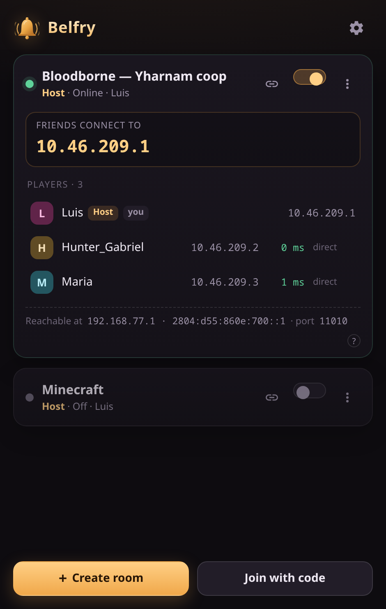

# Belfry

**Open-source virtual LAN for playing with friends — a Hamachi, Radmin VPN and ZeroTier alternative. Create a room, send the code, play as if you were on the same network.**

[](https://github.com/ludoviciphilip/belfry/releases/latest)
[](https://github.com/ludoviciphilip/belfry/actions/workflows/build.yml)
[](LICENSE)
[](#install)

[Download](https://github.com/ludoviciphilip/belfry/releases/latest) · [Features](#belfry) · [Install](#install) · [Docs](#how-it-works) · [Português](README.pt-BR.md)



Belfry is a small, free, open-source alternative to Hamachi and Radmin VPN for Windows and Linux — a LAN party app for playing games online with friends over a peer-to-peer virtual LAN:

- **No account, no member limit, no central server.** The PC that creates the room is the room's server. Nothing goes through Belfry's own infrastructure, because there is none.
- **Direct connections.** Players connect peer-to-peer (UDP/TCP hole punching, IPv4 and IPv6); when a direct path is impossible, traffic goes through the host.
- **Encrypted.** Every room has its own random 96-bit secret, and the engine encrypts traffic between members (AES-GCM by default).
- **Chat and file sharing** inside each room: messages reach everyone directly and the host keeps the history for whoever was away; files are served straight from the sharer's PC (drag a file into the chat) and saved to `Downloads/Belfry`. Nothing is uploaded anywhere.
- **Several rooms at once**, each with its own subnet and virtual adapter.
- **Light**: one small window; the networking runs in a background service, so you can close the window (or keep it in the tray) while playing.
- **Updates itself** (Windows installer and Linux AppImage): signed updates from GitHub Releases, checked on start.

The networking engine is [EasyTier](https://github.com/EasyTier/EasyTier) (LGPL-3.0), shipped unmodified. Belfry adds the app, the room codes, the service that manages one engine process per room, and the installers.

## How it works

1. **Create a room.** You get a code that starts with `BLF`. It contains the room's identity and secret plus your public IPv4/IPv6 address and port.
2. **Friends paste the code** in *Join with code*.
3. Everyone gets an address like `10.46.209.x`. The host is always **`.1`**: that's the IP you type in the game (for example in Bloodborne co-op, Minecraft *Direct Connection* `10.46.209.1:PORT`, or any game with "connect by IP").

## Install

Download from [Releases](https://github.com/ludoviciphilip/belfry/releases):

| System | File | Notes |
|---|---|---|
| Windows 10/11 | `Belfry_x.y.z_x64-setup.exe` | Asks for admin once (installs the service and the network driver). |
| Linux | `.AppImage`, `.deb` or `.rpm` | On first start, click **Enable Belfry** and type your password once (pkexec). |

On Linux the service lives in `/opt/belfry` and runs as `belfryd.service`. Remove it with `sudo /opt/belfry/belfryd uninstall`.

## If friends can't connect

The host's PC must be reachable from the internet on the room's port (shown in the room card, `11010` for the first room):

- **IPv6**: most Brazilian (and many other) ISPs give every home a public IPv6. If both sides have it, it usually just works, even behind CGNAT. Some routers block incoming IPv6 by default; allow the port in the router's IPv6 firewall.
- **IPv4**: Belfry asks the router to open the port (UPnP). If UPnP is off, forward **TCP and UDP** on the room's port to the host PC.
- **CGNAT and no IPv6?** Then nobody can reach your PC directly. Let a friend who is reachable host the room, or run your own relay (any cheap VPS) and put its address in *Settings → Advanced → Extra server* before creating the room:

  ```bash
  # on the VPS: relays only Belfry rooms, never anyone else's traffic
  ./easytier-core --relay-network-whitelist "belfry-*"
  ```

## Build from source

Needs Rust (stable), Node.js and, on Linux, `webkit2gtk-4.1`.

```bash
npm ci
bash scripts/fetch-engine.sh linux     # or: windows (downloads EasyTier, checks SHA-256)
npm run build                           # builds belfryd + the bundles
```

`npm run dev` runs the app in development mode. Tests: `cargo test -p belfry-proto -p belfryd`, and `unshare -rn bash scripts/e2e-netns.sh` runs a full host + guest session in network namespaces without root.

### Layout

| Path | What |
|---|---|
| `crates/belfry-proto` | Room code format (versioned, checksummed base32) and the API types |
| `crates/belfryd` | Background service: one EasyTier process per room, loopback JSON API with a token, Linux systemd / Windows service install |
| `src-tauri` | The app (Tauri 2) |
| `ui` | The interface: plain HTML, CSS and JavaScript, no build step |

## Alternatives

Belfry, Hamachi, Radmin VPN and ZeroTier all let you play LAN-only games over the internet by putting your PC and your friends' PCs on a virtual LAN. The differences:

- **Hamachi** (LogMeIn Hamachi) and **Radmin VPN** are free for small groups but closed-source, Windows-first, and historically capped the number of peers per network.
- **ZeroTier** is open-source and cross-platform, but needs a (free) account and a controller to manage the network.
- **Belfry** is open-source, needs no account, and has no member limit: the host's PC is the only "server," using [EasyTier](https://github.com/EasyTier/EasyTier) for peer-to-peer networking. Today it only ships for Windows and Linux.

*Hamachi and LogMeIn are trademarks of LogMeIn, Inc.; Radmin VPN is a trademark of Famatech Corp.; ZeroTier is a trademark of ZeroTier, Inc. Belfry is an independent project and is not affiliated with, sponsored by, or endorsed by any of them.*

## License

MIT. The bundled EasyTier binaries are LGPL-3.0; see `licenses/` and the `SOURCE.txt` shipped next to them.
