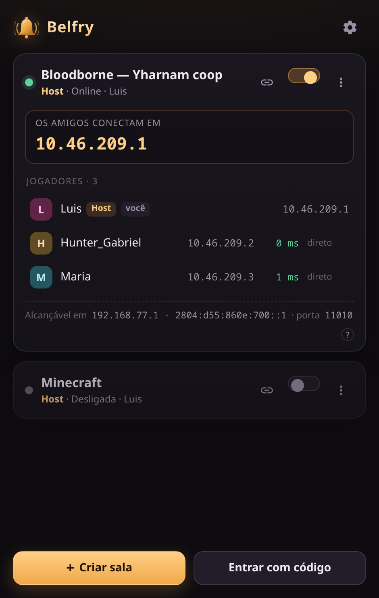

# Belfry

**Salas de LAN virtual pra jogar com os amigos. Crie uma sala, mande o código, joguem como se estivessem na mesma rede.**

[English](README.md)



O Belfry é uma alternativa pequena e gratuita ao Hamachi e ao Radmin VPN, pra Windows e Linux:

- **Sem conta, sem limite de pessoas, sem servidor central.** O PC de quem cria a sala é o servidor da sala.
- **Conexão direta** entre os jogadores (hole punching UDP/TCP, IPv4 e IPv6); quando não dá, o tráfego passa pelo host.
- **Criptografado**: cada sala tem um segredo aleatório próprio.
- **Várias salas ao mesmo tempo**, cada uma com sua sub-rede e seu adaptador virtual.
- **Leve**: a rede roda num serviço em segundo plano, então dá pra fechar a janela (ou deixar na bandeja) enquanto joga.
- **Se atualiza sozinho** (instalador do Windows e AppImage no Linux): atualizações assinadas, verificadas ao abrir.

O motor de rede é o [EasyTier](https://github.com/EasyTier/EasyTier) (LGPL-3.0), distribuído sem modificações.

## Como usar

1. **Crie uma sala.** Você recebe um código que começa com `BLF`.
2. **Os amigos colam o código** em *Entrar com código*.
3. Todo mundo ganha um IP tipo `10.46.209.x`. O host é sempre o **`.1`**: é esse IP que vai no jogo (coop do Bloodborne, Minecraft *Conexão direta* `10.46.209.1:PORTA`, qualquer jogo com "conectar por IP").

## Instalação

Baixe em [Releases](https://github.com/ludoviciphilip/belfry/releases):

| Sistema | Arquivo | Observação |
|---|---|---|
| Windows 10/11 | `Belfry_x.y.z_x64-setup.exe` | Pede administrador uma vez (instala o serviço e o driver de rede). |
| Linux | `.AppImage`, `.deb` ou `.rpm` | Na primeira vez, clique em **Ativar o Belfry** e digite sua senha (pkexec). |

## Se os amigos não conseguirem conectar

O PC do host precisa ser alcançável pela internet na porta da sala (aparece no card da sala; `11010` na primeira):

- **IPv6**: a maioria das operadoras brasileiras dá IPv6 público. Se os dois lados têm, costuma funcionar direto, mesmo com CGNAT. Alguns roteadores bloqueiam entrada IPv6 por padrão: libere a porta no firewall IPv6 do roteador.
- **IPv4**: o Belfry pede pro roteador abrir a porta (UPnP). Se o UPnP estiver desligado, redirecione **TCP e UDP** da porta da sala pro PC do host.
- **CGNAT e sem IPv6?** Aí ninguém alcança seu PC direto. Deixe um amigo alcançável ser o host, ou rode um relay seu (qualquer VPS barata) e coloque o endereço em *Configurações → Avançado → Servidor extra* antes de criar a sala:

  ```bash
  # na VPS: repassa só salas do Belfry
  ./easytier-core --relay-network-whitelist "belfry-*"
  ```

## Licença

MIT. Os binários do EasyTier incluídos são LGPL-3.0; veja `licenses/`.
